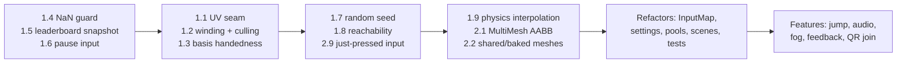

# Endless Ride – Godot Port Review & Improvement Plan

Review of the Godot 4.8 (.NET 10 / C#) port under [`godot/`](file:///home/rengglian/EndlessRide/godot). I read every script, the scene, shader, project/export settings, embedded `remote.html` and the imported model metadata (~4,200 lines of C#).

> [!NOTE]
> I couldn't compile in the review sandbox because the NuGet SDK resolver couldn't run there. Everything below comes from reading the code. Items marked **(verify)** are rendering effects I worked out on paper; check them in-engine before fixing.

---

## 0. Summary

| Severity | Count | Highlights |
|---|---|---|
| 🔴 High | 9 | UV seam every 1200 m, inverted terrain winding + `cull_disabled` (lighting/shadows), mirrored bases on scenery/obstacles, NaN from UDP freezes the horse, leaderboard cross-thread race, no way to pause locally, every run is identical (fixed seed), Pro-speed obstacle patterns can be impossible, 60 Hz physics-driven visuals cause judder on 50 Hz TVs |
| 🟠 Medium | 17 | MultiMesh AABB bloat, WorkerThreadPool tasks never awaited, level-triggered start/restart input, horse gallops in place during countdown/pause, unshared obstacle meshes (hundreds of draw calls), unused trimesh colliders, Android TV back button/focus handling, port/timeout mismatches with docs… |
| 🟡 Low | 25+ | Dead code, duplicated math, off-by-one ids, rounding mismatches, log spam, emoji glyphs, etc. |

---

## 1. 🔴 High-Priority Bugs

### 1.1 Texture seam / smear every 1200 m (UV wrap inside a chunk) [RESOLVED]
- Calculated `chunkV0` once per chunk in `TrackMath.cs`.
- Monotonic V interpolation across each chunk prevents GPU interpolation inversions at wrap intervals while preserving original lateral derivative filtering.

### 1.2 Terrain triangle winding and shading [RESOLVED]
- Restored original quad index order with `render_mode cull_disabled`, avoiding directional normal mismatch and lighting blowout.

### 1.3 Scenery, obstacles and collectibles use a mirrored (left-handed) basis [RESOLVED]
- Replaced left-handed bases in `ObstacleManager.cs`, `CollectibleManager.cs`, and `TrackChunk.cs` with orthonormal right-handed transforms (`SplineTrack.GetTransformAt`).
- Bounded MultiMesh inactive instance transforms to `sceneryPos` rather than `(0, 0, 0)`, preventing bounding box inflation across the world origin.
- Adjusted adventurer rider upper and lower arm bone Euler rotations along local Z so arms reach forward to grip the reins rather than splaying into a T-pose.

### 1.4 A malformed UDP packet can lock the horse in a NaN state permanently [RESOLVED]
- Added `float.IsFinite(steer)` validation discarding invalid packets.
- Switched to `BinaryPrimitives.ReadSingleLittleEndian`.
- Replaced 1000ms staleness with 350ms active window guard.

### 1.5 Leaderboard is read on WebSocket threads while the main thread changes it [RESOLVED]
- Backed `LeaderboardManager.Entries` with thread-safe immutable array snapshots under lock.
- Added tie-breaking by timestamp on identical scores.
- Sanitized remote player names against control characters and length limit.

### 1.6 No way to pause from keyboard, gamepad or TV remote
*Note: Pausing intentionally reserved for companion app per user preference; synchronized pause/resume state broadcasts across Godot and companion web app.*

### 1.7 Obstacle seed control and tracking [RESOLVED]
- Added configurable `ActiveSeed` defaulting to `1337`.
- Exposed track seed control in the companion web app with manual entry and a 🎲 Random generator button.
- Embedded `Seed` into `LeaderboardEntry`, HUD game-over rankings (`#1337`), and companion web app leaderboard tables.

### 1.8 Obstacle patterns can become physically impossible at high speed [RESOLVED]
- Added reachability constraint to `TrackMath.GenerateObstacleAnchors`: constrained double-obstacle open lanes to adjacent lanes when the distance gap between rows is under 24m, preventing impossible 2-lane jumps at high gallop speeds.

### 1.9 Gameplay and camera run only in `_PhysicsProcess` (judder on 50 Hz / 120 Hz displays)
[GameManager.cs#L168](file:///home/rengglian/EndlessRide/godot/Scripts/Core/GameManager.cs#L168), [RunnerCamera.cs#L31](file:///home/rengglian/EndlessRide/godot/Scripts/Camera/RunnerCamera.cs#L31)

The horse, camera and collectible animation only move at the 60 Hz physics tick. European TVs (and the Shield's 50 Hz/59.94 Hz modes) or 120/144 Hz monitors will show regular stutter, which is very noticeable in a fast forward-scrolling game.
**Fix:** enable `physics/common/physics_interpolation=true` (supported for 3D since 4.4) and call `ResetPhysicsInterpolation()` on teleports (restart, pool acquire). Or move the visual updates (camera, transforms) into `_Process` and keep only the simulation in the physics tick.

---

## 2. 🟠 Medium-Priority Issues

### Rendering & Performance
1. **Hidden MultiMesh instances at the world origin inflate the AABB. [RESOLVED]** Inactive MultiMesh slots are now anchored at `sceneryPos` with scale 0 instead of `(0, 0, 0)`, keeping each chunk's AABB tightly bounded and allowing proper frustum culling.
2. **Obstacle and collectible meshes aren't shared.** [ObstaclePool.cs#L123-L283](file:///home/rengglian/EndlessRide/godot/Scripts/Obstacles/ObstaclePool.cs#L123-L283), [CollectiblePool.cs#L89-L130](file:///home/rengglian/EndlessRide/godot/Scripts/Collectibles/CollectiblePool.cs#L89-L130). The class comment says "shared geometries", but every entity creates its own `SphereMesh`/`BoxMesh`. With 64 pre-pooled obstacles × 6–13 `MeshInstance3D`s that's ~600 nodes, and **6–13 draw calls per visible obstacle** on a Tegra X1 with the GL Compatibility renderer. **Fix:** create meshes once per type, or better, bake each obstacle type into one `ArrayMesh` with `SurfaceTool` (one draw call per material), or use a MultiMesh per type.
3. **Trimesh collider built for every chunk but never used.** [TrackChunk.cs#L85-L88](file:///home/rengglian/EndlessRide/godot/Scripts/Track/TrackChunk.cs#L85-L88), [#L157-L160](file:///home/rengglian/EndlessRide/godot/Scripts/Track/TrackChunk.cs#L157-L160). Nothing raycasts or uses physics, yet `GetFaces()` + `ConcavePolygonShape3D` runs on the main thread for each chunk (800 tris) and populates the broadphase. Remove it, or keep it behind a flag.
4. **Main-thread mesh conversion.** [TrackChunk.cs#L132-L152](file:///home/rengglian/EndlessRide/godot/Scripts/Track/TrackChunk.cs#L132-L152). The worker produces `float[]`, which the main thread converts to `Vector3[]` and then into a new `ArrayMesh`. Have the worker emit `Vector3[]`/`Vector2[]` directly, and build the arrays on the worker. Optionally reuse the ArrayMesh with `ClearSurfaces()`.
5. **Shadow settings are heavy for the Shield.** [Main.tscn](file:///home/rengglian/EndlessRide/godot/Scenes/Main.tscn): `directional_shadow_max_distance = 180` with the default 4 PSSM splits. Try 2 splits and about 60–80 m, and expose a quality preset.
6. **No fog, so streaming pop-in is visible.** Chunks appear 200 m ahead and the meadow ends hard at ±36 m. Add depth fog (sky-coloured) in the `Environment`, which also hides the terrain edge.
7. **`WorkerThreadPool.AddTask` tasks are never waited on.** [TrackChunkManager.cs#L142-L154](file:///home/rengglian/EndlessRide/godot/Scripts/Track/TrackChunkManager.cs#L142-L154). Godot's docs require every task to be completed via `WaitForTaskCompletion`, or its resources leak (and you get warnings on exit). Since the work is pure C#, `Task.Run(...)` is simpler. Otherwise store the task IDs and wait on them in `_Process`/`_ExitTree`.
8. **Restart clears the world for a frame or two.** [TrackChunkManager.cs#L39-L59](file:///home/rengglian/EndlessRide/godot/Scripts/Track/TrackChunkManager.cs#L39-L59). `InitTrack` hides every chunk and waits for the workers, so the countdown can start on an empty void. Terrain geometry is seed-independent, so keep the meshes and regenerate only the anchors (or swap chunks only once their replacements arrive).

### Gameplay / State Machine
9. **Start/restart input is level-triggered. [RESOLVED]** Added single-frame edge triggers for Space/Click inputs and a 0.6s lockout timer upon entering `GameOver`, preventing accidental skipping of the post-crash game over screen.
10. **Horse gallops in place during the countdown and while paused.** [HorseRunnerController.cs#L369-L374](file:///home/rengglian/EndlessRide/godot/Scripts/Entities/HorseRunnerController.cs#L369-L374): `Reset()` calls `PlayGallopAnimation()`. `AnimationPlayer` keeps running when `State == Paused` because the game doesn't use `GetTree().Paused`. Play `Idle` during the countdown. For pause, use `GetTree().Paused = true`, with `ProcessMode = Always` on the network nodes and HUD.
11. **Difficulty and player name can change mid-run. [RESOLVED]** Added run-lock queuing in `GameManager`: changes during `Running` or `Countdown` are queued and cleanly applied on the next run (`StartGame()`), preventing leaderboard record tampering.
12. **No auto-pause on focus loss, and Android TV Back quits the app.** Handle `NotificationApplicationFocusOut`/`NotificationApplicationPaused` and `NotificationWMGoBackRequest` (set `application/config/quit_on_go_back=false`), and map Back to pause → menu.
13. **Gamepad: hard-coded device 0, no deadzone rescale.** [GameManager.cs#L269-L273](file:///home/rengglian/EndlessRide/godot/Scripts/Core/GameManager.cs#L269-L273). On the Shield the controller isn't always device 0. Define InputMap actions (`steer_left/right` with joy-axis events on all devices) and use `Input.GetAxis("steer_left","steer_right")`, which handles deadzone and all devices. Today steering also jumps from 0 to 0.15 at the deadzone edge.

### Networking
14. **Port and timeout mismatches with the docs.** [HardwareUdpReceiver.cs#L20-L29](file:///home/rengglian/EndlessRide/godot/Scripts/Networking/HardwareUdpReceiver.cs#L20-L29). The primary UDP port is **8080** (README/class doc say 8081). `IsActive` uses **1000 ms**, but the comments say 250 ms ([L15](file:///home/rengglian/EndlessRide/godot/Scripts/Networking/HardwareUdpReceiver.cs#L15)) and 350 ms ([GameManager.cs#L275](file:///home/rengglian/EndlessRide/godot/Scripts/Core/GameManager.cs#L275)). Since the last steer value is reused, a dropped controller keeps the horse steering for up to **1 s**. Use ~250 ms and decay to 0.
15. **UDP state is written from two receive threads without synchronization.** [HardwareUdpReceiver.cs#L111-L163](file:///home/rengglian/EndlessRide/godot/Scripts/Networking/HardwareUdpReceiver.cs#L111-L163). `_hzPacketCounter`, `PacketCount`, `_lastRestartState` etc. can race when both ports receive. `seq` isn't used to drop duplicate or out-of-order packets, and any LAN host can inject steering. Push packets into a `ConcurrentQueue` and process them on the main thread, filter by `seq` (wrap-aware), and optionally lock onto the first device IP.
16. **WebSocket receive ignores `EndOfMessage`.** [CompanionWebServer.cs#L223-L240](file:///home/rengglian/EndlessRide/godot/Scripts/Networking/CompanionWebServer.cs#L223-L240). Messages over 4 KB or split into fragments get parsed partially. Accumulate until `EndOfMessage` and cap the size.
17. **Player name isn't validated.** [CompanionWebServer.cs#L310-L316](file:///home/rengglian/EndlessRide/godot/Scripts/Networking/CompanionWebServer.cs#L310-L316). The length is unbounded and control characters pass through. The name is persisted, drawn in the HUD and broadcast to every phone. Trim, cap at ~16 chars and strip control characters. Also, `_lastDifficulty` is assigned **before** validation ([L305](file:///home/rengglian/EndlessRide/godot/Scripts/Networking/CompanionWebServer.cs#L305)), so an invalid string is cached and re-broadcast. In `remote.html` the `difficulty` value is inserted unescaped into a `class` attribute and HTML (L1344).

---

## 3. 🟡 Low-Priority Bugs & Nits

| # | Location | Issue |
|---|---|---|
| 1 | [RunnerCamera.cs#L81-L84](file:///home/rengglian/EndlessRide/godot/Scripts/Camera/RunnerCamera.cs#L81-L84) | `RotateZ` rotated in parent space. **[RESOLVED]** Switched to `RotateObjectLocal(Vector3.Back, _currentRoll)` so roll strictly rotates around the view axis. |
| 2 | [TrackChunkManager.cs#L90](file:///home/rengglian/EndlessRide/godot/Scripts/Track/TrackChunkManager.cs#L90), [GameManager.cs#L338](file:///home/rengglian/EndlessRide/godot/Scripts/Core/GameManager.cs#L338), pickups | Log spam (one line per chunk, every 50 m, every pickup). It's costly on Android logcat. Gate it behind `OS.IsDebugBuild()` or a verbose flag. |
| 3 | [TrackChunk.cs#L42-L53](file:///home/rengglian/EndlessRide/godot/Scripts/Track/TrackChunk.cs#L42-L53) | `LoadMeshFromGltf` instantiates a scene and **never frees it** (4 orphan nodes). It only takes the first mesh and **drops the node transform**, so `BushMeadow.glb`'s authored scale `(1.2, 0.75, 1.1)` is lost. Free the instance and bake `meshInst.Transform` into the MultiMesh transforms. |
| 4 | [TrackChunk.cs#L171](file:///home/rengglian/EndlessRide/godot/Scripts/Track/TrackChunk.cs#L171) | `Math.Abs(int)` throws `OverflowException` for `int.MinValue` (reachable through wrapping multiplication). Use `uint` hashing. The variant hash on [L190](file:///home/rengglian/EndlessRide/godot/Scripts/Track/TrackChunk.cs#L190) is poorly distributed. Reuse Mulberry32 with the run seed. |
| 5 | [TrackMath.cs#L289](file:///home/rengglian/EndlessRide/godot/Scripts/Track/TrackMath.cs#L289) | `Math.Clamp(t, 0, uint.MaxValue)` does nothing; remove it. Creating a closure per call is fine, but a small `struct Mulberry32` avoids the allocation. |
| 6 | [TrackMath.cs#L127-L151](file:///home/rengglian/EndlessRide/godot/Scripts/Track/TrackMath.cs#L127-L151) | `ComputeGeometricBankAngle` and `ComputeVisualBankAngle` are the same formula. The `abs(speed-12) < 0.001` switch (also in `SplineTrack.GetBankingAngleAtDistance`) adds nothing. Keep one function. It also uses `x''` instead of true curvature `x''/(1+x'²)^{3/2}`; that's fine, but document it. |
| 7 | [TrackMath.cs#L65-L76](file:///home/rengglian/EndlessRide/godot/Scripts/Track/TrackMath.cs#L65-L76) vs [#L200-L276](file:///home/rengglian/EndlessRide/godot/Scripts/Track/TrackMath.cs#L200-L276) | The cross-section profile exists twice (arrays plus hand-coded `if` ladders), and the slope uses hand-averaged constants at the kinks. Derive height and slope from the single table by piecewise-linear interpolation. |
| 8 | [track_meadow.gdshader#L76](file:///home/rengglian/EndlessRide/godot/Shaders/track_meadow.gdshader#L76) | The shader curb is 3.8–4.15 m, but the geometry curb is 3.8–4.0 m, so the curb colour bleeds onto the meadow slope. |
| 9 | [track_meadow.gdshader#L31](file:///home/rengglian/EndlessRide/godot/Shaders/track_meadow.gdshader#L31), [#L39](file:///home/rengglian/EndlessRide/godot/Shaders/track_meadow.gdshader#L39) | Anti-moiré only looks at `fwidth(x)`, but the worst aliasing is along s at grazing angles; use `max(fwidth(stoneUv.x), fwidth(stoneUv.y))`. Gravel hashes a **continuous** coordinate, producing per-pixel white noise that sparkles; use `floor(stoneUv * 8.0)`. |
| 10 | [HorseRunnerController.cs#L330-L345](file:///home/rengglian/EndlessRide/godot/Scripts/Entities/HorseRunnerController.cs#L330-L345) | On crash the `Death` animation **and** a manual 0.5 rad roll / −0.4 m drop are applied, so the horse may sink into the road **(verify)**. The rider teleports to a fixed pose. A short tween, camera shake or slow-mo would sell the crash. |
| 11 | [HorseRunnerController.cs#L316-L327](file:///home/rengglian/EndlessRide/godot/Scripts/Entities/HorseRunnerController.cs#L316-L327) | Reins use `PrimitiveType.Lines`, which is 1 px wide on every GPU and practically invisible on a 4K TV. Use thin camera-facing quads or a `TubeTrailMesh`. `Roughness` on an unshaded material does nothing. |
| 12 | [GirlRiderEntity.cs#L151-L160](file:///home/rengglian/EndlessRide/godot/Scripts/Entities/GirlRiderEntity.cs#L151-L160) | `Foot.L/R` are IK-target bones parented to `Root` in the Quaternius rig. Moving them doesn't drag the shins, so the feet can float apart from the legs **(verify)**. The hard-coded `9.0f` speed constants ([L44](file:///home/rengglian/EndlessRide/godot/Scripts/Entities/GirlRiderEntity.cs#L44), [L276](file:///home/rengglian/EndlessRide/godot/Scripts/Entities/GirlRiderEntity.cs#L276)) ignore the difficulty base speed. |
| 13 | [GameManager.cs#L419](file:///home/rengglian/EndlessRide/godot/Scripts/Core/GameManager.cs#L419) vs [InGameHUD.cs#L413](file:///home/rengglian/EndlessRide/godot/Scripts/UI/InGameHUD.cs#L413) | The leaderboard stores `(int)` (truncated) while the HUD shows `N0` (rounded), so they can differ by 1. The next physics tick also overwrites the `finalScore` passed in `TriggerGameOver`. `Max(Score, Distance)` is redundant because Score ≥ distance always. |
| 14 | [GameManager.cs#L229-L232](file:///home/rengglian/EndlessRide/godot/Scripts/Core/GameManager.cs#L229-L232) | Telemetry timer resets to 0 instead of `-= 0.05`, so the rate drifts below 20 Hz. |
| 15 | [InGameHUD.cs#L393-L394](file:///home/rengglian/EndlessRide/godot/Scripts/UI/InGameHUD.cs#L393-L394) | "GO!" is never shown: the state switches to `Running` at 0 and hides the modal. Show it for ~0.5 s into the run. |
| 16 | [InGameHUD.cs#L108-L109](file:///home/rengglian/EndlessRide/godot/Scripts/UI/InGameHUD.cs#L108-L109) | Emoji (🍎🧲🏆🥇) depend on a system emoji font (tofu boxes where it's missing). 🧲 is a **magnet**, not a horseshoe. Ship icons (`TextureRect`) or a bundled emoji font. |
| 17 | [InGameHUD.cs#L311-L343](file:///home/rengglian/EndlessRide/godot/Scripts/UI/InGameHUD.cs#L311-L343) | 15–18 px fonts at 1080p are too small for a TV viewed from 3 m (10-foot UI guidance is ≥ 24–28 px). Prompts say "SPACE / TAP"; on Android TV it should say "Press OK / (A)". |
| 18 | [InGameHUD.cs#L360-L379](file:///home/rengglian/EndlessRide/godot/Scripts/UI/InGameHUD.cs#L360-L379) | Seven interpolated strings are allocated every physics tick, which means GC pressure on Android. Update only when the integer value changes. `_cachedLeaderboard`, `_highlightRank` and `_isNewRecord` are written but never read. |
| 19 | [LeaderboardManager.cs#L61-L70](file:///home/rengglian/EndlessRide/godot/Scripts/Core/LeaderboardManager.cs#L61-L70) | A corrupt or unparsable file is **overwritten with defaults**, so all scores are lost. Back up to `.bak` first. Saves aren't atomic (write `tmp` → rename). `List.Sort` is unstable, so ties rank randomly; tie-break on timestamp. Default entries have `Timestamp = 0`. |
| 20 | [HardwareUdpReceiver.cs#L28](file:///home/rengglian/EndlessRide/godot/Scripts/Networking/HardwareUdpReceiver.cs#L28), [#L29](file:///home/rengglian/EndlessRide/godot/Scripts/Networking/HardwareUdpReceiver.cs#L29) | `IsRestartPressed` is set but never reset or read. `IsActive` is true for the first second after launch (`_lastPacketTimeMs = 0`). |
| 21 | [CompanionWebServer.cs#L249-L252](file:///home/rengglian/EndlessRide/godot/Scripts/Networking/CompanionWebServer.cs#L249-L252) vs [#L346-L351](file:///home/rengglian/EndlessRide/godot/Scripts/Networking/CompanionWebServer.cs#L346-L351) | The semaphore can be disposed while a send is still pending; `sem.Release()` in `finally` then throws an unobserved `ObjectDisposedException`. |
| 22 | [CompanionWebServer.cs#L373](file:///home/rengglian/EndlessRide/godot/Scripts/Networking/CompanionWebServer.cs#L373) | `players` list duplicates "Rider 1" when it is the active name. |
| 23 | [remote.html#L1034](file:///home/rengglian/EndlessRide/godot/remote.html#L1034) | WS port is hard-coded to 8080 while `HttpPort` is `[Export]`-configurable. Use `window.location.port` when it's served by Godot. |
| 24 | [ObstaclePool.cs#L125](file:///home/rengglian/EndlessRide/godot/Scripts/Obstacles/ObstaclePool.cs#L125) / [#L277](file:///home/rengglian/EndlessRide/godot/Scripts/Obstacles/ObstaclePool.cs#L277) (same in `CollectiblePool`) | `Id = _nextId` after `_nextId++`, so each Id is off by one from the node name. |
| 25 | [HorseRunnerController.cs#L291-L305](file:///home/rengglian/EndlessRide/godot/Scripts/Entities/HorseRunnerController.cs#L291-L305) | `GlobalPosition` and then `GlobalBasis` are set separately, which means two transform propagations. Set `GlobalTransform` once. The variable `right` is actually the horse's left (+X); the maths is correct, but rename it for clarity. |
| 26 | [CollectiblePool.cs#L110-L119](file:///home/rengglian/EndlessRide/godot/Scripts/Collectibles/CollectiblePool.cs#L110-L119) | The "horseshoe" is a full closed torus. Use a partial arc (custom mesh / CSG) so it reads as a horseshoe. |

---

## 4. Architecture & Code Quality

1. **One source of truth for track-space transforms.** The same `point + lateral*u + up*h` / basis code appears in the horse, obstacles, collectibles and scenery (with the handedness bug in 3 of 4). Add `SplineTrack.GetSurfaceTransform(s, u, alignToSlope)` and use it everywhere.
2. **Generic pool.** `ObstaclePool` and `CollectiblePool` (and their managers' swap-remove/recycle logic) are nearly identical. Use a `Pool<TKey, TEntity>`. The lane-offset `switch` is duplicated too; move it to `Config.LaneOffsets.For(LaneType)`.
3. **Prefer scenes and resources over code-built nodes.** The HUD (~400 lines), obstacles and the procedural horse are built in code, which makes visual iteration slow. Convert them to `.tscn` scenes (`HUD.tscn`, `Obstacle_Rock.tscn`, …) and expose tuning through `[Export]`/`Resource` classes (e.g. a `DifficultyConfig : Resource`) so designers can tweak in the inspector.
4. **Decouple GameManager.** It wires 9 events, polls input, scores, broadcasts and drives the HUD. Split it: `InputRouter` (keyboard/gamepad/UDP/web → `steer`, `start`, `pause`), `ScoreSystem` and `RemoteBridge`, with Godot signals between them. The repeated `Difficulty.ToString().ToLowerInvariant()` / `BroadcastRoomState(...)` calls (6×) should be one `PublishRoomState()`.
5. **Define an InputMap in `project.godot`.** It's currently empty and all keys are hard-coded (`Key.A`, `Key.D`, `Key.P`, `Key.Space`), so players can't remap.
6. **Persist settings.** Difficulty, player name, `InvertX`, `CalOffset` and `Sensitivity` reset on every launch. Save them to `user://settings.cfg` (`ConfigFile`).
7. **Spline parameter vs metres.** `Distance` is the spline parameter `s` (≈ world Z), not arc length ([TrackMath.cs#L102-L110](file:///home/rengglian/EndlessRide/godot/Scripts/Track/TrackMath.cs#L102-L110)). The score, HUD "m", obstacle spacing and the horse wheelbase probes are all in parameter units (off by up to ~6 % on curves). Either document it, or track true arc length for the displayed distance.
8. **Floating-point origin.** World positions grow without bound (Z = s). At ~16 km the float32 step is 2 mm and at ~65 km it's 8 mm, so long sessions will start to jitter. Add an origin shift (rebase every N km) or apply a `-playerZ` offset to the world root.
9. **Dead code.** `SplineTrack.GetTransformAt`, `GetNormalAtDistance`, `GetGeometricBankAngle`, `GetVisualBankAngle`, `GetGroundHeight`, `GetGroundSlope`, `GetPointAtDistance`, `TrackChunkManager.TryGetChunk`, `Config.BoardHoldToStartSeconds` and `HardwareUdpReceiver.IsRestartPressed` are unused (and `GetTransformAt` is the *correct* basis, see 1.3).
10. **Hot-path JSON.** Telemetry serializes an anonymous type through reflection at 20 Hz. Use `System.Text.Json` source generation (`[JsonSerializable]`) to cut allocations, and serialize once per broadcast (already done). It also makes the code trim/AOT-safe for Android.
11. **Unit tests.** `TrackMath` is pure and deterministic, which makes it ideal for xUnit tests: Mulberry32 parity with the TS version, deterministic anchors per seed, "no row ever blocks all three lanes", reachability (1.8), and UV continuity (1.1).

---

## 5. Build, Tooling & Project Settings

1. **`run.sh` fallback can't work.** [run.sh#L4-L6](file:///home/rengglian/EndlessRide/run.sh#L4-L6) falls back to Godot 4.7.2, but the project declares feature `4.8` and the csproj requires `Godot.NET.Sdk/4.8.0-beta.1`. Fail with a clear message instead, or honour a `GODOT_BIN` env var.
2. **Beta engine plus .NET 10.** Pin it and document it. Consider the latest 4.x stable for Android TV releases (C# on Android is still marked experimental in Godot).
3. **Release signing uses the debug keystore** ([export_presets.cfg#L55-L60](file:///home/rengglian/EndlessRide/godot/export_presets.cfg#L55-L60)) with the password committed in plain text. Fine for sideloading, but the APK can never be updated through the Play Store. Create a release keystore and move credentials to `GODOT_ANDROID_KEYSTORE_RELEASE_*` env vars.
4. **Three copies of `remote.html`.** There's `public/remote.html`, `godot/remote.html` as an EmbeddedResource, and the same file again in the `.pck` through `include_filter="*.html"`. Link the single source: `<EmbeddedResource Include="../public/remote.html" LogicalName="EndlessRide.remote.html" />`, and drop the `.pck` copy and the disk fallback.
5. **Android TV manifest.** Make sure the leanback launcher and `android.hardware.touchscreen required=false` are set (Godot's Android TV options), and test D-pad navigation of the game-over screen.
6. **Physics tick / v-sync.** Set `physics/common/physics_ticks_per_second` explicitly and enable interpolation (see 1.9). Consider `display/window/vsync/vsync_mode` adaptive on desktop.
7. **Profiling hook.** Add a toggleable debug overlay (FPS, draw calls, `Performance.GetMonitor(RenderTotalDrawCallsInFrame)`, active chunks/obstacles, UDP Hz). The repo already has a `webgl-profiling` skill with targets you can mirror.

---

## 6. Feature & UX Suggestions

1. **Jump mechanic.** Hurdles, fences and logs are classic jumpables, and `Horse.gltf` already ships `Gallop_Jump` and `Jump_toIdle`. Map the AtomS3 button, gamepad A or a phone "jump" to it, and give hurdles a height so that clearing them counts.
2. **Audio.** There's none: no hoofbeats (sync them to `GallopPhase`), pickup chimes, crash, countdown beeps or music. Add an `AudioManager` with pooled `AudioStreamPlayer3D`.
3. **Pickup feedback.** Add a floating "+25 ×1.4" label, a particle burst (`GPUParticles3D` is costly on GLES3, `CPUParticles3D` is fine) and a HUD multiplier pulse.
4. **Speed sensation.** FOV warp exists. Add speed lines or a subtle radial blur at high speed, plus grass/flower billboards near the path (MultiMesh) for parallax.
5. **Near-miss bonus.** Award points for passing within 0.3 m of an obstacle (cheap to compute in `CheckPlayerCollision`).
6. **Leaderboard UX.** Per-difficulty leaderboards (Pro vs Relaxed scores aren't comparable today), a "daily seed" board, and a QR code / IP on the start screen pointing to `http://<ip>:8080/` so phones can join without typing.
7. **Controller status in the TV HUD.** Show a small AtomS3 connected/Hz indicator and the calibration state directly on screen, not just in the phone app.
8. **Accessibility.** Colour-blind-safe hurdle colours (red/white plus pattern), a steering-sensitivity slider, and a "practice" mode without speed ramp.

---

## 7. Suggested Fix Order

1. **Quick, safe fixes (< 1 h):** 1.4, 1.5, 1.6, 2.9, 2.14, Low #1/#14/#20.
2. **Visual correctness:** 1.1, 1.2, 1.3, then verify in-engine with the normal-debug shader.
3. **Gameplay fairness:** 1.7, 1.8, 2.11.
4. **Performance on the Shield:** 1.9, 2.1–2.5, 2.7. Measure draw calls before and after.
5. **Architecture and tests,** then **features**.
