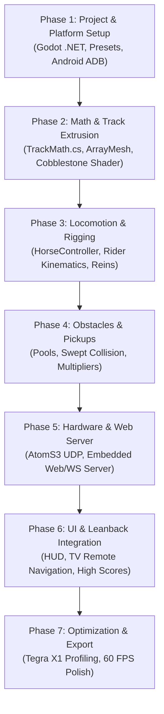

# EndlessRide: Porting Guide to Godot 4 with C#

Comprehensive guide for porting **EndlessRide** from TypeScript/Three.js to **Godot 4 (.NET / C#)**, targeting:
1. **NVIDIA Shield TV** (Android TV / Tegra X1) as a dedicated, standalone living-room console.
2. **Linux Desktop (x86_64)** for instant local testing, debugging, and iteration.

---

## 1. Target System Architecture

The port eliminates the Raspberry Pi and the external Python bridge (`sensor_bridge.py`). The Godot C# application running on the NVIDIA Shield TV acts as the single central hub:

```
                          ┌────────────────────────────────┐
                          │         M5Stack AtomS3         │
                          │   (Wireless IMU Motion Reins)  │
                          └──────────────┬─────────────────┘
                                         │ Wi-Fi UDP (Binary packets @ 50 Hz, Port 8081)
                                         ▼
┌────────────────────────────────────────────────────────────────────────────────────────┐
│                        NVIDIA SHIELD TV (Android TV / Tegra X1)                        │
│                                                                                        │
│  ┌──────────────────────────────────────────────────────────────────────────────────┐  │
│  │                             Godot 4.7 (.NET 10 / C#)                             │  │
│  │                                                                                  │  │
│  │  ┌───────────────────────┐  ┌───────────────────────┐  ┌──────────────────────┐  │  │
│  │  │  Hardware UDP Listener│  │ Embedded Web Server   │  │  Save State Manager  │  │  │
│  │  │  (Port 8081 - AtomS3) │  │  (Port 8080 - HTTP/WS)│  │  (user://leaderboard)│  │  │
│  │  └──────────┬────────────┘  └───────────┬───────────┘  └──────────────────────┘  │  │
│  │             │                           │                                        │  │
│  │             └─────────────┬─────────────┘                                        │  │
│  │                           ▼                                                      │  │
│  │  ┌────────────────────────────────────────────────────────────────────────────┐  │  │
│  │  │                           EndlessRide Core Engine                          │  │  │
│  │  │  • Procedural Spline Extrusion (ArrayMesh on Worker Threads)               │  │  │
│  │  │  • Custom Cobblestone & Rolling Meadow Spatial Shader                      │  │  │
│  │  │  • Horse Locomotion, Kinematic Rider Leaning & Procedural Reins            │  │  │
│  │  │  • Obstacle & Collectible Object Pools with Swept Collision                │  │  │
│  │  │  • CanvasLayer In-Game HUD & Android TV Leanback UI                        │  │  │
│  │  └────────────────────────────────────────────────────────────────────────────┘  │  │
│  └──────────────────────────────────────────┬───────────────────────────────────────┘  │
└─────────────────────────────────────────────┼──────────────────────────────────────────┘
                         │                    │
        HDMI 2.0 (4K/60) │                    │ Local Wi-Fi HTTP & WebSocket (:8080)
                         ▼                    ▼
               ┌──────────────────┐  ┌─────────────────────────────────┐
               │    Living Room   │  │    Smartphone Companion Remote  │
               │      TV Display  │  │    (Safari / Chrome Web App)    │
               └──────────────────┘  └─────────────────────────────────┘
```

---

## 2. Prerequisites & Environment Setup

### 2.1 Linux Development Machine
1. **.NET SDK**: Install .NET 10 SDK (`dotnet-sdk-10.0`).
2. **Godot Engine**: Download **Godot 4.7+ .NET Edition** (x86_64 Linux).
3. **Android Workload for .NET**:
   ```bash
   dotnet workload install android
   ```
4. **Android SDK & OpenJDK 17**:
   - Install Android Command Line Tools (`cmdline-tools`), Build Tools (34.0.0+), and Android NDK (r25+).
   - In Godot: **Editor > Editor Settings > Export > Android**:
     - Set **Android SDK Path** (`~/Android/Sdk`).
     - Set **Java SDK Path** (`/usr/lib/jvm/java-17-openjdk`).
5. **Android TV Debug Bridge (ADB)**:
   ```bash
   sudo apt install adb
   ```

### 2.2 NVIDIA Shield TV Setup
1. Open **Settings > Device Preferences > About**.
2. Scroll to **Build** and click it 7 times to enable **Developer Options**.
3. Under **Developer Options**:
   - Turn **USB Debugging** ON.
   - Turn **Network Debugging** ON (note the IP address, e.g. `192.168.1.150:5555`).
4. On your Linux dev host, verify the wireless connection:
   ```bash
   adb connect 192.168.1.150:5555
   adb devices
   # Expected: 192.168.1.150:5555 device
   ```

### 2.3 M5Stack AtomS3 Reins Setup
- Update [`scripts/m5stack_atoms3_reins/m5stack_atoms3_reins.ino`](file:///home/rengglian/repos/EndlessRide/scripts/m5stack_atoms3_reins/m5stack_atoms3_reins.ino) to send UDP packets to the target IP:
  - During development: Linux PC IP (e.g. `192.168.1.50`).
  - In production: NVIDIA Shield TV IP (e.g. `192.168.1.150`).
  - Target UDP port: `8081`.

---

## 3. Recommended Project Structure

```
godot/
├── project.godot                     # Godot project settings
├── EndlessRide.csproj                # .NET C# project file
├── export_presets.cfg                # Linux x86_64 & Android TV presets
│
├── Scenes/
│   ├── Main.tscn                     # Master scene (GameManager, Lighting, World)
│   ├── Entities/
│   │   ├── Horse.tscn                # Horse mesh + Skeleton3D + AnimationPlayer
│   │   └── Rider.tscn                # Rider mesh + procedural bone offsets
│   ├── Environment/
│   │   ├── TrackChunk.tscn           # ArrayMesh chunk + MultiMeshInstance3D trees
│   │   ├── Obstacles/                # Hurdle.tscn, FallenLog.tscn, Rock.tscn
│   │   └── Collectibles/             # Apple.tscn, Horseshoe.tscn
│   └── UI/
│       ├── HUD.tscn                  # CanvasLayer: Speed, Score, Multiplier, Leaderboard
│       └── LeanbackMenu.tscn         # TV start / pause / game-over menus
│
├── Scripts/
│   ├── Core/
│   │   ├── GameManager.cs            # State machine (Start, Countdown, Running, GameOver)
│   │   └── Config.cs                 # Speeds, multipliers, cross-section tables
│   ├── Track/
│   │   ├── TrackMath.cs              # Pure math Catmull-Rom spline & extrusion logic
│   │   ├── SplineTrack.cs            # Dynamic waypoint management & curve sampling
│   │   ├── TrackChunk.cs             # ArrayMesh builder & MultiMesh tree distributor
│   │   └── TrackChunkManager.cs      # Multithreaded chunk streaming & pooling
│   ├── Entities/
│   │   ├── HorseRunnerController.cs  # Lateral steer physics, banking, 4-point ground sample
│   │   ├── GirlRiderEntity.cs        # Kinematic spine sway, head stabilization
│   │   └── ReinsRope.cs              # Procedural rein curves (ImmediateMesh)
│   ├── Obstacles/
│   │   ├── ObstacleManager.cs        # Lane placement & swept distance collision
│   │   └── ObstaclePool.cs           # Object recycling
│   ├── Collectibles/
│   │   ├── CollectibleManager.cs     # Coin/Apple collection, multiplier logic
│   │   └── CollectiblePool.cs        # Object recycling
│   ├── Camera/
│   │   └── RunnerCamera.cs           # Spline lookahead, follow lag, dynamic FOV
│   ├── Networking/
│   │   ├── HardwareUdpReceiver.cs    # 50 Hz binary UDP receiver for AtomS3
│   │   └── CompanionWebServer.cs     # Embedded .NET HttpListener & WebSocket server
│   └── UI/
│       ├── HUDController.cs          # UI element updater
│       └── DebugOverlay.cs           # Framerate, draw calls, IMU telemetry overlay
│
├── Shaders/
│   └── TrackCobblestone.gdshader     # Ported procedural limestone, mortar & meadow shader
│
├── Assets/
│   ├── Models/                       # horse.gltf, rider models, hurdles
│   ├── Textures/                     # UI textures, sky panoramas
│   └── WebCompanion/                 # public/remote.html embedded for web clients
```

---

## 4. Step-by-Step Implementation Roadmap



### Phase 1: Engine Initialization & Dual-Target Presets (Day 1–2)
1. Initialize Godot 4.7+ project with **C# (.NET 10)**.
2. Configure **Project Settings**:
   - `rendering/renderer/rendering_method`: Set to **`gl_compatibility`** (for rock-solid performance on Shield Tegra X1) or **`mobile`** (Vulkan Mobile).
   - `input_devices/pointing/emulate_touch_from_mouse`: `true` (enables mouse testing of touch drag).
3. Create Export Presets in `export_presets.cfg`:
   - **Linux/X11**: Standard x86_64 binary.
   - **Android**:
     - Architecture: check `arm64-v8a`.
     - Permissions: check `Internet` and `Access Network State`.
     - Category **Android TV**: check `Is Android TV`, provide 320x180 Leanback banner.

### Phase 2: Procedural Track, Threading & Shader (Day 3–5)
1. **Port `trackMath.ts` to `TrackMath.cs`**:
   - Convert `CROSS_SECTION_OFFSETS` (-36m to +36m) and `CROSS_SECTION_HEIGHTS` to C# static readonly arrays.
   - Implement `EvaluateSpline()`, `GetSplineFrame()`, and vertex/normal generation using `Godot.Vector3`.
2. **Chunk Generation with `ArrayMesh`**:
   - Replace Three.js `BufferGeometry` with `ArrayMesh.AddSurfaceFromArrays()`.
   - Run chunk generation asynchronously using C# `Task.Run()` or Godot's `WorkerThreadPool` to prevent main-thread stutter.
3. **Procedural Scenery with `MultiMeshInstance3D`**:
   - In Three.js, trees were individual meshes. In Godot, use `MultiMeshInstance3D` per chunk for trunks, foliage, and bushes.
4. **Port the Cobblestone Shader to `TrackCobblestone.gdshader`**:
   - Translate Three.js GLSL into Godot Spatial Shader language:
   ```glsl
   shader_type spatial;
   render_mode blend_mix, depth_draw_opaque, cull_back;

   varying vec2 v_track_uv;

   float hash12(vec2 p) {
       vec3 p3 = fract(vec3(p.xyx) * 0.1031);
       p3 += dot(p3, p3.yzx + 33.33);
       return fract((p3.x + p3.y) * p3.z);
   }

   void vertex() {
       v_track_uv = UV;
   }

   void fragment() {
       float u = v_track_uv.x;
       float s = v_track_uv.y;
       float abs_u = abs(u);

       // Cobblestone paver tiles (0.4m x 0.5m)
       vec2 stone_uv = vec2(u * 2.5, s * 2.0);
       vec2 tile_id = floor(stone_uv);
       if (mod(tile_id.y, 2.0) == 1.0) {
           stone_uv.x += 0.5;
           tile_id = floor(stone_uv);
       }
       vec2 tile_fract = fract(stone_uv);
       float edge_dist = min(min(tile_fract.x, 1.0 - tile_fract.x), min(tile_fract.y, 1.0 - tile_fract.y));
       float mortar_mask = 1.0 - smoothstep(0.04, 0.09, edge_dist);

       // Staggered paving within path limits (3.8m), gravel/grass blend outside
       vec3 paver_color = mix(vec3(0.85, 0.83, 0.78), vec3(0.40, 0.38, 0.35), mortar_mask);
       vec3 meadow_color = vec3(0.18, 0.45, 0.14);

       float road_mask = 1.0 - smoothstep(3.5, 4.0, abs_u);
       ALBEDO = mix(meadow_color, paver_color, road_mask);
       ROUGHNESS = 0.85;
   }
   ```

### Phase 3: Horse, Rider & Camera (Day 6–8)
1. **Import Models**: Drop `horse.gltf` into Godot; extract `AnimationPlayer`.
2. **Locomotion (`HorseRunnerController.cs`)**:
   - Update forward distance along spline by `Speed * delta`.
   - Steer laterally via smoothed tilt angle. Clamp to `±MAX_LATERAL_OFFSET` (3.4m).
   - Sample spline position + lateral vector, sample track pitch/roll, and apply orientation via `Transform3D.Basis`.
3. **Rider Kinematics (`GirlRiderEntity.cs`)**:
   - Attach rider scene to horse saddle bone via `BoneAttachment3D`.
   - Procedurally rotate spine bones (`Spine1`, `Spine2`, `Neck`) proportional to lateral acceleration and banking.
4. **Procedural Reins (`ReinsRope.cs`)**:
   - In Three.js, reins used dynamic line curves. In Godot, use `ImmediateMesh` drawing a quadratic Bezier curve between rider hands and horse bit bones each frame.
5. **Follow Camera (`RunnerCamera.cs`)**:
   - Smoothly interpolate position behind horse (`LookAhead` tangent + height offset).
   - Adjust `Fov` dynamically between 60° (low speed) and 78° (high speed).

### Phase 4: Obstacles & Pickups (Day 9–10)
1. **Pooling System**:
   - Maintain pre-instantiated lists of `Hurdle`, `FallenLog`, `Apple`, `Horseshoe` nodes.
2. **Swept Collision Detection**:
   - Check distance along track: `Mathf.Abs(playerDistance - obstacleDistance) < obstacleLength`.
   - Check lateral offset: `Mathf.Abs(playerLateral - obstacleLateral) < collisionWidth`.
3. **Multiplier Mechanics**:
   - Score multiplier increments with pickups, decays toward 1.0x after a inactivity window.

### Phase 5: Hardware & Companion Networking (Day 11–12)
1. **UDP Receiver for M5Stack AtomS3 (`HardwareUdpReceiver.cs`)**:
   ```csharp
   using System;
   using System.Net;
   using System.Net.Sockets;
   using System.Threading.Tasks;
   using Godot;

   public partial class HardwareUdpReceiver : Node
   {
       [Signal] public delegate void TiltDataReceivedEventHandler(float steer, float rawTilt, bool btnPressed);
       private UdpClient _udpClient;
       private bool _running = true;

       public override void _Ready()
       {
           _udpClient = new UdpClient(8081);
           Task.Run(ReceiveLoop);
       }

       private async Task ReceiveLoop()
       {
           while (_running)
           {
               var result = await _udpClient.ReceiveAsync();
               byte[] data = result.Buffer;
               if (data.Length >= 8) // Matches M5Stack binary packet structure
               {
                   float tilt = BitConverter.ToSingle(data, 0);
                   bool btn = data[4] == 1;
                   float steer = Mathf.Clamp(tilt / 25.0f, -1.0f, 1.0f);
                   CallDeferred(MethodName.EmitSignal, SignalName.TiltDataReceived, steer, tilt, btn);
               }
           }
       }

       public override void _ExitTree()
       {
           _running = false;
           _udpClient?.Close();
       }
   }
   ```
2. **Embedded Companion Web Server (`CompanionWebServer.cs`)**:
   - Use .NET `HttpListener` on port `8080`.
   - When requested at `/remote`, stream the contents of `res://Assets/WebCompanion/remote.html`.
   - When requested at `/ws`, upgrade the HTTP connection to a native .NET `WebSocket` to broadcast telemetry (score, distance, multiplier) and receive tare/start commands.

### Phase 6: UI, HUD & Game Loop (Day 13–14)
1. **In-Game HUD**:
   - Recreate the top dashboard using Godot `Control` nodes (`CanvasLayer`):
     - Rider name, score, distance, multiplier progress bar, and apples count.
2. **Android TV Leanback Navigation**:
   - Ensure all buttons in the Start, Pause, and Game Over dialogs support focus navigation via D-Pad (Shield Remote or Gamepad).
3. **Save System**:
   - Store high scores and settings to `user://leaderboard.json` using `System.Text.Json` or Godot's `ConfigFile`.

---

## 5. Development & Testing Workflow

### 5.1 Local Linux Workflow (Daily Iteration)
1. Open the project in the Godot Editor on Linux.
2. Press **`F5`** to launch instantly.
3. Test steering via keyboard (`A`/`D` or Left/Right arrows) or connect the M5Stack AtomS3 directly to your Linux PC IP.
4. Open `http://localhost:8080/remote` in your desktop browser to interact with the companion app side-by-side with the game.

### 5.2 Wireless Deploy to NVIDIA Shield TV
Once ready to test on the living-room TV:
1. Connect via ADB over Wi-Fi:
   ```bash
   adb connect 192.168.1.150:5555
   ```
2. In the top-right corner of the Godot Editor, click the **Android Device Dropdown** and select `NVIDIA SHIELD Android TV`.
3. Click **One-Click Deploy** (the Android icon).
4. Godot builds the APK, pushes it over Wi-Fi, installs it, launches the app on your TV, and streams the log output directly back to your editor console.
5. To view real-time Android logs from your terminal:
   ```bash
   adb logcat -s "godot:*"
   ```

---

## 6. NVIDIA Shield Performance Checklist

- **Keep Screen Awake**: Call `DisplayServer.ScreenSetKeepOn(true);` during `_Ready()` to prevent Android TV ambient mode / screen timeout.
- **Rendering Method**: Use `gl_compatibility` in Project Settings. The Maxwell GPU on the Tegra X1 handles OpenGL ES 3.0 flawlessly at locked 60 FPS.
- **VRAM & Texture Compression**: Ensure all imported textures use VRAM Compressed format (ETC2 / ASTC).
- **Zero GC Allocations**: In high-frequency loops (`_Process`, spline evaluation), use pre-allocated variables and C# `struct` parameters to prevent garbage collector pauses.
- **MultiMesh Draw Calls**: Ensure roadside scenery (trees and foliage) is batched into `MultiMeshInstance3D` nodes to keep draw calls below 50 per frame.
